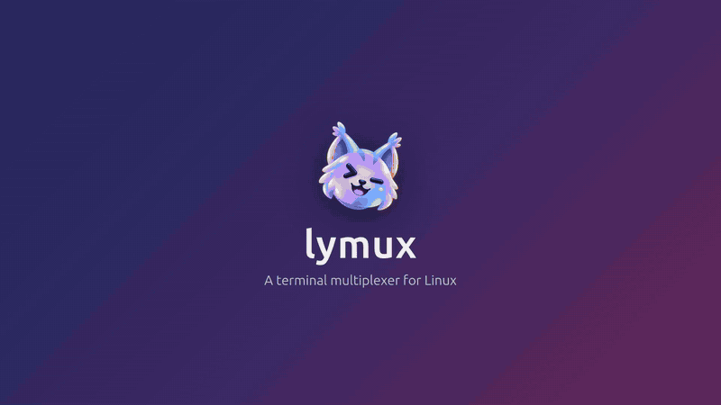

<p align="center"></p>

# lymux

> **lymux** is to Linux what wmux is to Windows and cmux is to macOS. Formerly *amux* and *lynmux*; your saved layout carries over automatically.

A [wmux](https://github.com/kevmtt/wmux)/[cmux](https://cmux.com)-style terminal multiplexer for Linux: a workspace sidebar, draggable split panes, and session persistence. cmux is macOS-only and wmux is Windows-only; lymux fills that gap on Linux.



<sub>Recorded from the app itself with `npm run demo`. Full-quality MP4 in the [latest release](https://github.com/adlynfakhreyz/lymux/releases/latest).</sub>

> Early stage (v0.7). Expect rough edges.

## Install

Download from [Releases](https://github.com/adlynfakhreyz/lymux/releases):

- **.deb** (Ubuntu/Debian): `sudo apt install ./lymux_0.7.0_amd64.deb`. Adds lymux to your app menu with its icon.
- **AppImage** (any distro): `chmod +x lymux-0.7.0-x86_64.AppImage && ./lymux-0.7.0-x86_64.AppImage`. Needs FUSE (`sudo apt install libfuse2t64` on Ubuntu 24.04).

## Features

- Workspaces in a sidebar, each showing its current directory and git branch; drag one to reorder
- Split panes right/down, resize by dragging dividers
- Drag a pane by its header onto another pane: drop on an edge to dock it there, or in the middle to swap
- Layout, sizes and each pane's directory are saved and restored on relaunch
- Translucent background, so desktop blur like Blur my Shell shows through
- Font size zoom with `Ctrl+=` / `Ctrl+-` / `Ctrl+0` or Ctrl+scroll (a small indicator shows the size briefly)
- Resizable sidebar (drag its right edge); close it to a thin rail, or switch to auto-hide so it slides out when the pointer reaches the left edge
- Bundled JetBrains Mono + Nerd Font symbols, so powerlevel10k/starship prompts render out of the box
- GPU (WebGL) rendering with pixel-aligned box and powerline glyphs
- File viewer panes: `lymux open README.md` shows rendered Markdown (GitHub style: tables, task lists, highlighted code, images) or an image beside your terminal. It re-renders when the file changes on disk, so you can watch an agent write a document. Viewers drag, dock, swap and close like terminals, have their own zoom (header − / + or Ctrl+scroll over them), and are restored with the session
- Scriptable: a `lymux` CLI and an MCP server let AI coding agents (and scripts) create workspaces, split panes, run commands in them and read their output

## Build from source

```bash
git clone https://github.com/adlynfakhreyz/lymux.git && cd lymux
npm install      # also rebuilds node-pty for Electron
npm run dev      # dev mode with hot reload
npm run dist     # build AppImage + .deb into dist/
npm run test:e2e # drive the real window: drag, zoom, sidebar, the lymux CLI and MCP server
npm run demo     # record docs/demo.gif and dist/lymux-demo.mp4
```

`npm run dev` and `npm start` pass `--no-sandbox` because Ubuntu 24.04's AppArmor blocks Chromium's sandbox for unpackaged Electron. The .deb installs a proper setuid sandbox; the AppImage opts out of the sandbox automatically for the same reason.

## Shortcuts

| Keys | Action |
|---|---|
| Ctrl+Shift+D | Split active pane right |
| Ctrl+Shift+E | Split active pane down |
| Ctrl+Shift+W | Close active pane |
| Ctrl+Shift+N | New workspace |
| Ctrl+PgUp / Ctrl+PgDn | Previous / next workspace |
| Ctrl+Shift+B | Toggle sidebar |
| Ctrl+= / Ctrl+- / Ctrl+0 | Terminal font zoom in / out / reset (also Ctrl+scroll over a terminal) |
| Ctrl+scroll over a file viewer | Zoom that viewer (or its header − / + buttons; click the % to reset) |
| Double-click workspace | Rename |
| Drag pane header | Move pane (edge = dock, middle = swap) |

## Agents and scripts

Every shell inside lymux has a `lymux` command on its PATH and knows its own pane (`$LYMUX_PANE_ID`). So an agent like
Claude Code, Codex or Gemini CLI running in a pane can drive the app: lay out panes, start a dev server beside itself,
run tests in another pane and read the result.

```bash
lymux list                                            # workspaces and panes
P=$(lymux split --down --cmd 'npm run dev' -d)        # new pane below this one, without taking focus
lymux wait -p "$P" --for 'ready in' --timeout 60      # block until the server is up
lymux send -p "$P" 'npm test' --enter --wait '^Tests:' --timeout 120   # run a command, print its output
lymux read -p "$P" --lines 40                         # what is on that terminal now
lymux keys -p "$P" C-c                                # stop it
lymux new-workspace --name review --cwd ~/src/app     # a new sidebar entry
V=$(lymux open docs/plan.md --down -d)               # show a file below, without taking focus
lymux open notes.md --reuse                           # show it in the last viewer pane instead of a new one
lymux read -p "$V"                                    # a viewer's file as text (Markdown source)
```

`lymux open` shows a file in a read-only viewer pane next to yours (or next to `-p PANE`) and prints its pane id. If the
file is already open in that workspace, it focuses that pane instead. Markdown (`.md`) and images (`.png .jpg .gif .webp
.svg`) are supported; viewers re-render when the file changes. `lymux reload -p` re-reads it, `lymux list` shows the
file instead of a directory, and `send`, `keys` and `wait` refuse viewer panes. Links in Markdown open in your browser,
and relative links to other supported files open in the same pane.

`lymux help` lists every command. Tell your agent about it, for example with a line in `CLAUDE.md`/`AGENTS.md`:
*"You are running inside lymux; run `lymux help` to open panes and run commands beside you."*

**MCP.** `lymux mcp` serves the same commands as MCP tools (`split_pane`, `send_text`, `read_pane`, `wait_for_output`, `open_file`, `reload_pane`, ...)
over stdio, for agents that prefer tools or don't run in a terminal:

```bash
claude mcp add lymux -- ~/.config/lymux/bin/lymux mcp     # Claude Code
```

For other clients, use the command `~/.config/lymux/bin/lymux` with the argument `mcp`. To use the CLI from terminals
outside lymux, add `~/.config/lymux/bin` to your PATH. Commands then target the focused pane unless given `-p`.

How it works: the app serves a user-only unix socket (`~/.config/lymux/control.sock`, newline-delimited JSON). At launch
it writes `~/.config/lymux/bin/lymux`, a small wrapper that runs the CLI with the app's own Electron in Node mode, so
there is nothing extra to install.

## Architecture

```
main process (Node)                         renderer (React)
├─ PtyManager: one shell per pane id  ⇄ IPC ⇄ ├─ Sidebar: workspaces, cwd, git branch
├─ session.ts: ~/.config/lymux/session.json    ├─ SplitView: layout tree → resizable panels
├─ git.ts: branch per pane cwd                ├─ TerminalPane → TerminalEngine (xterm.js today)
├─ files.ts: allowlisted reads, watches ⇄ IPC ⇄ ├─ ViewerPane → FileRenderer (Markdown, image, ...)
└─ control.ts: control socket  ──── IPC ────▶ └─ control.ts: answers it with the layout functions
     ▲
lymux CLI / lymux mcp (cli.ts, mcp.ts, run as plain Node)
```

- **Layout** is a tree (`src/shared/types.ts`): splits (`row`/`column`, with sizes) and pane leaves. A leaf with a `view` (`{ path, kind, zoom? }`) is a file viewer; without one, a terminal. All edits are pure functions in `src/renderer/src/state/layout.ts`.
- **Terminal engine** is behind the `TerminalEngine` interface (`src/renderer/src/terminal/engine.ts`). xterm.js implements it now; the plan is to swap in libghostty-vt once its API is stable, without touching layout or sidebar code.
- **Registry** (`terminal/registry.ts`) keeps each pane's engine alive outside React, so splitting (which re-parents panes) never loses scrollback.
- **File viewers**: `viewer/registry.ts` keeps each viewer's DOM, scroll position and file watch alive outside React, like the terminal registry. The main process (`src/main/files.ts`) only serves files the renderer opened through `file:open` (a supported format, checked there), plus images in an opened Markdown file's folder, and watches them for changes (debounced 200ms). Markdown is sanitized with DOMPurify, and links never navigate the window.
- **Adding a file format**: write `src/renderer/src/viewer/renderers/<kind>.ts`, whose default export extends `FileRenderer` (`viewer/renderer.ts`: `mount`, `update(bytes)`, `text()`, `setZoom`, `resize`, `dispose`), and add one line to `FORMATS` in `src/shared/formats.ts` (kind, label, extensions, size limit, live reload). The renderer is loaded with `import()` the first time a file of that kind opens.
- **Control socket** (`src/main/control.ts`, protocol in `src/shared/control.ts`): layout requests go to the renderer, which owns the session (`src/renderer/src/control.ts`); waits watch the raw pty stream in the main process.
- **Persistence (v1)**: workspaces, splits, sizes and each pane's cwd (read from `/proc/<pid>/cwd`) are auto-saved and restored on launch. Shells start fresh on restore.

## Roadmap

1. More file viewers: PDF and spreadsheets (`.xlsx .xls .ods .csv .tsv`), then opening files by Ctrl+clicking paths in terminal output or dragging them in from the file manager.
2. Agent status in the sidebar: Claude Code hooks report to the control socket via `lymux` (working / needs input / done), shown as dots per workspace.
3. Shells that survive closing the app: move PtyManager into a background daemon the app connects to.
4. Drag panes to other workspaces.
5. AppArmor profile so the AppImage and dev builds can keep Chromium's sandbox.
6. Swap xterm.js for libghostty-vt.

## License

[MIT](LICENSE). Bundled fonts keep their own licenses (OFL-1.1 and MIT); see [THIRD_PARTY_NOTICES.md](THIRD_PARTY_NOTICES.md).
